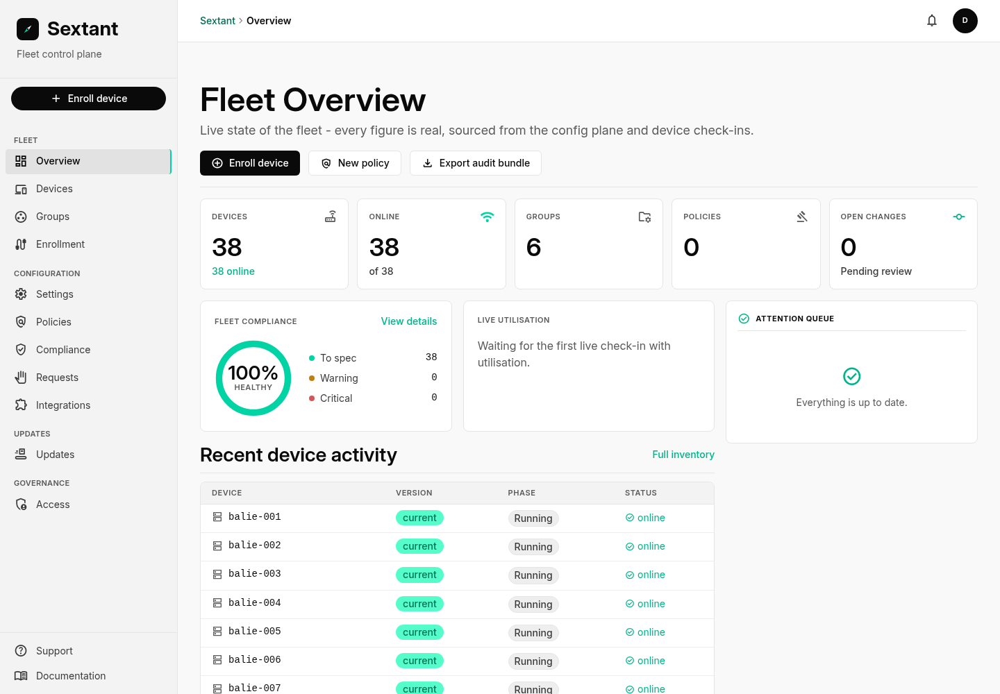
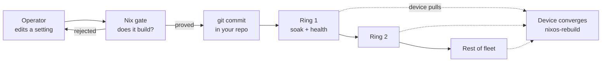
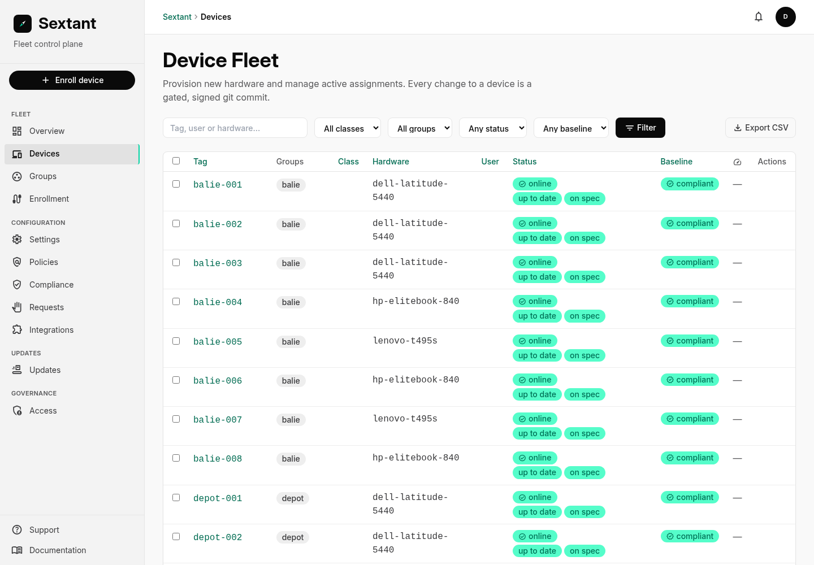

<div align="center">

# Sextant

**Manage a fleet of NixOS workstations the way you manage code.**

[](LICENSE)
[](#status-beta)
[](go.mod)
[](https://docs.sextantfleet.com)

[Documentation](https://docs.sextantfleet.com) ·
[Quickstart](#quickstart) ·
[Decision records](docs/adr/) ·
[Contributing](CONTRIBUTING.md) ·
[Security](SECURITY.md)

A [DAWO community](https://dawo.community) project, stewarded by BB Open.

</div>
<br>

Every device's configuration is data in git. Nix builds it, a gate proves it
compiles before anyone can merge it, and the fleet rolls forward in rings you
control. The console shows you what each machine **actually** runs, not what
you hoped it would.



## Quickstart

One command and a browser. No cluster, no account, nothing that leaves your
machine.

```sh
git clone https://codeberg.org/DAWO/DAWO-Sextant.git && cd DAWO-Sextant/deploy/compose
podman-compose up -d          # or: docker compose up -d
```

Then open **http://127.0.0.1:8080**, choose **Sign in with SSO** and then
**a test user**, and you are the owner. What runs is what production runs:
the console, its database, and the gate-runner that validates every change
before it becomes a commit. The identity provider is a test one that lets
anyone in, which is why everything listens on 127.0.0.1 only.

The first `up` builds two images and takes a few minutes; `down -v` throws
everything away again. The [compose README](deploy/compose/README.md) says
what runs and how to start over.

To install it for real, start the console with nothing configured. It opens
in **setup mode**, prints a one-time link in its log, and asks in the
browser for what it needs - keys, the fleet repository, your identity
provider - then restarts with you signed in as owner. See
[Install and configure Sextant](docs/handbook/src/operators/deploy.md).

## Why this exists

Public organisations are told to modernise their workplace and to stay in
control of their own infrastructure, and the tools on offer make you pick one.
The mature fleet managers are excellent and they are somebody else's cloud:
your device inventory, your policies and your compliance evidence live where
you cannot see them and cannot leave.

Sextant is the other option. It is a control plane you run yourself, over
NixOS, where the fleet's configuration is a document in your own git
repository. You can read it, diff it, review it, and hand it to an auditor. No
agent phones a vendor. Devices **pull** their configuration and the console
never pushes to them, so there is no remote command channel to abuse - not by
us, not by anyone who gets in.

That is the conviction: **a fleet you can explain is a fleet you control.**

## How a change reaches a device



Nothing is pushed. A ring's branch moves only after the change builds and the
previous ring stayed healthy through its soak, and each device picks up its own
ring's revision on its own schedule.

## What it does

<details open>
<summary><b>Configuration</b> - settings that resolve org → group → device, with locks</summary>

- Settings resolve along organisation → group → device, with locks so a higher
  scope can hold a value a lower one may not weaken.
- Policies are the layer above: a name and a reason an auditor can read,
  enforcement, and drift that gets re-checked rather than written once.
- Policies also carry *conditions* about a device's observed state - free disk
  space, how long since it checked in. Those cannot be enforced, only checked,
  and the console says so instead of pretending the fleet will converge them
  away. A device that reports no measurement is never accused of failing one.
- Every option your overlay publishes appears in the console by itself. There
  is no second list to keep in step.

</details>

<details>
<summary><b>Change and rollout</b> - a gate that must pass, then rings</summary>

- Submit a change, a gate builds it, and nobody merges what does not compile.
  Four-eyes approval when you want it.
- Rollouts run in rings: soak times, health thresholds, device caps, pins,
  optional auto-flow.
- A wave that stops making progress becomes an action item naming the devices
  holding it up, instead of waiting silently forever.
- High-risk changes ask for an explicit extra confirmation.

</details>

<details>
<summary><b>Devices</b> - imaging, intents rather than remote control, secrets</summary>

- Imaging from a provisioning station, installing the revision that device's
  ring is pinned to - not whatever `main` happens to be that afternoon.
- Remote *intents*, never remote control: lock a session, collect diagnostics,
  crypto-wipe a lost machine. A wipe needs the device armed, and reports back
  when it refuses or does not finish.
- Secrets with agenix, where a newly imaged device's host key is registered as
  a recipient automatically - otherwise the classic silent failure.
- Disk-encryption recovery keys escrowed, every reveal in the audit log.
- Hardware models are a filter, not a fourth scope. Pick a model in the console
  and give it settings of its own, scoped to the devices that are that model.
  The fingerprint reader driver a Lenovo in a group needs, and the Dell beside
  it does not, is one screen rather than a fork in the tree. The disk layout and
  imaging steps come with the model from your overlay, and the page shows
  them.

</details>

<details>
<summary><b>Fleet health</b> - one board of things that need a person</summary>

- One board of action items: never checked in, offline, errored, running an
  unrecognised configuration, failing a policy condition.
- A configuration that lags is a warning. A *system* that lags becomes a real
  issue once it persists. Reporting them identically teaches people to ignore
  both.
- Devices read as matching or not matching. Revision hashes are there for the
  operator who asks, not for everyone who looks.

</details>

<details>
<summary><b>Integrations</b> - mesh, directory, endpoint security, as ordinary settings</summary>

- NetBird mesh, directory login over LDAP/LDAPS with SSSD, Wazuh endpoint
  security, OpenBao, and any SMTP server for notifications.
- Endpoint controls: USB device control with an allowlist, printing, and
  per-capability user rights - so somebody can join a WiFi network or approve a
  dock without anyone handing out an administrator password.
- A device page lists every integration the fleet has switched on for that
  device, and whether it is actually running there. Configured and running are
  different questions, and an integration that is switched on but silent is the
  one worth seeing. A device that has not reported yet says so, rather than
  being read as broken.

</details>

<details>
<summary><b>Evidence</b> - the auditor's cross-reference, and scoped access</summary>

- Audit log of who changed what and when, an evidence export, CSV exports, and
  per-policy BIO/ISO control annotations: the auditor's cross-reference from a
  framework to the thing that actually enforces it.
- Access is scoped, so an operator responsible for a few groups sees those
  groups.

</details>



## Running it for real

The quickstart above is a simulation on your laptop: a throwaway database, no
cluster, no identity provider and validation switched off. A real instance
needs four things, and it is worth knowing that before you invest an
afternoon:

| | |
|---|---|
| **An overlay repository** | A git repo that consumes a NixOS core flake and holds your `fleet.json`. One per organisation. This is the same repo the devices follow, so it is the product's actual source of truth - not a copy of one. |
| **Postgres** | The observed plane: check-ins, tokens, image jobs, preferences, notifications. A single instance beside the console is enough. |
| **An OIDC identity provider** | Console login, mapped to roles by directory group. LDAP optionally supplies the group picker. |
| **A validation gate** | The nix evaluation that proves a change builds before it can be committed. In production this runs out-of-process in a small gate-runner, fail-closed, because the console image deliberately ships no nix. |

There are four ways to run it, and all four are in
[Four ways to run Sextant](docs/handbook/src/operators/deployment-paths.md): the
compose stack in `deploy/compose` to try it on your own machine, the NixOS
module in `deploy/nixos`, a container on any host, or one Helm release plus a
secret (`deploy/helm`) on Kubernetes. The devices need
[DAWO-NixOS](https://code.overheid.nl/MinBZK/DAWO-NixOS) or your own core flake,
and they pull with comin - the console never connects to a device.

The full walk-through, including the values that matter and the ones that bite,
is [Install and configure Sextant](docs/handbook/src/operators/deploy.md).

**Platforms.** The flake builds for `x86_64-linux` and `aarch64-linux`, but the
released container images are single-architecture: they are built on an x86_64
runner with no multi-arch manifest, so on arm you build from the flake. Managed
devices are NixOS. Nothing here targets macOS or Windows, now or planned - the
configuration model is Nix, and that is the point rather than a gap to fill in
later.

## Who this is for

Written for public bodies running managed NixOS workstations, and useful to
anyone who has ever wondered what a laptop in the field is really running. If
you have a handful of machines, plain NixOS and a git repo already serve you
well - Sextant starts paying off when a person has to answer for what the fleet
is doing.

## Status: Beta

Feature-complete for its first production use and being prepared for one. The
fleet this is developed against runs it - imaging, rollouts in rings, directory
login, endpoint security and disk-encryption escrow, on real hardware.

Beta means the shape is settled and the remaining work is proving it rather
than designing it. Expect the APIs and the fleet document schema to stay put.
Expect rough edges where the first fleet has not pushed yet, and expect us to
say which those are rather than pretend otherwise.

**Help wanted:** developers, testers and maintainers. The place to ask whether
this fits what you are doing - or to say it does not - is the project itself:
open an issue on [Codeberg](https://codeberg.org/DAWO/DAWO-Sextant/issues), or
find the wider DAWO community at [dawo.community](https://dawo.community).

A question in the open is worth more than one in a mailbox. Somebody else has
probably wondered the same thing, and the answer stays where they can find it.

## Contributing

We would genuinely like the company. This is a small project doing something
ambitious, and the useful work is not all deep in the domain model.

**Good places to start**

- **Hardware profiles.** Every laptop model needs a disk layout and imaging
  notes. If you have a machine we do not, that is a self-contained
  contribution with an obvious test: image it.
- **Translations.** The console ships English and Dutch. Adding a language is
  one map in `internal/http/web/catalog.go`.
- **Integrations.** They are ordinary fleet settings: a NixOS module that
  publishes options, with no console change needed. The how-to is
  [Build your own integration](docs/handbook/src/extending/integration.md).
- **Run it against your own fleet and tell us what broke.** Honestly the most
  valuable thing anyone can do. The rough edges we know about are named in the
  status section above; the ones we do not are the point.
- **Documentation.** If a page assumed knowledge you did not have, that is a
  bug and we would like the report.

**How we work.** Small commits that explain *why* rather than what. Tests that
assert a behaviour somebody could plausibly get wrong, not coverage for its own
sake. Decisions that shape the product go in an ADR, and we would rather argue
about a design in writing than discover the disagreement in code review.

See CONTRIBUTING.md for the mechanics, CODE_OF_CONDUCT.md for how we talk to
each other, and SECURITY.md if what you found should not be a public issue.

The ADRs in `docs/adr/` are worth reading even if you never run this: they are
where the arguments are, including the ones we lost.

## Where this repository lives, and where it is built

Three forges, and they are not interchangeable. This table is the answer;
`CONTRIBUTING.md` and `docs/house-rules.md` point here rather than repeating
it.

| | |
|---|---|
| **codeberg.org/DAWO/DAWO-Sextant** | Where to read it, clone it, and take part today. Issues, pull requests and CI, on a runner attached here. Flux reads `main` here for the chart, so a merge reaches the cluster from this forge. Kept up to date. |
| **code.overheid.nl/MinBZK/DAWO-Sextant** | Canonical, and where it is published as EU open source. No public accounts yet. Kept up to date. |
| **git.edano.eu/bb-open/DAWO-Sextant** | BB Open's workshop, and today the only forge that builds a release: the tag, the images and the registry production pulls from live here. Not required to be current. |

Codeberg and code.overheid.nl are the two that have to be kept up to date. A
push that reaches one and not the other is silent, and the version served is
simply the older one.

There is one string attached to leaving forgejo behind, and it is worth
knowing before it bites: `release.yml` refuses to run anywhere else
(`github.server_url == 'https://git.edano.eu'`), because the registry
credentials live there. So a forge that may lag is also the only forge that
can cut a release, and a tag pushed to a stale forgejo builds the wrong tree.
Until the release moves, bring forgejo up to date before tagging.

**Container images are on BB Open's forge, not on Codeberg.** Each release
publishes `git.edano.eu/bb-open/sextant:<version>` (the console), `sextant:<version>-tools`,
`sextant-gate:<version>` and `sextant-docs:<version>`, each with an SPDX SBOM
under its own tag plus `-sbom`. They pull without an account. Codeberg would be
the natural home, but the gate image is about 630 MiB per release and the
default package quota there is 1.5 GiB, so two releases would fill it. The Helm
chart in `deploy/helm` points at these images by default.

Codeberg is the public front door because it is a European non-profit forge
rather than a company's platform, which is the same reasoning that put the
canonical copy on code.overheid.nl.

**CI runs on a self-hosted runner**, so a pull request opened on Codeberg gets
its checks where you can see them. `.forgejo/workflows/ci.yml` is in this
repository, so you can read exactly what runs.

**The end state is that all of it happens on code.overheid.nl** - the code, the
issues, the pull requests and the pipeline. Everything above is scaffolding
until the canonical repository is open and can build. We would rather describe
that honestly than present a temporary arrangement as the design.

## Architecture

Hexagonal: pure domain, use-case services, ports, adapters, thin transport.

```
internal/domain    pure model + scope/policy resolution (no I/O)
internal/app       use-case services
internal/ports     interfaces the app depends on
internal/adapters  git, nix, postgres, ldap, oidc, integrations
internal/http      SSR web (html/template, form-POST) and /api/v1 JSON
internal/platform  config, logging, metrics, server lifecycle
```

Server-rendered HTML and form posts. No framework, no build step for the front
end, and the console works without JavaScript. The design is in
`docs/architecture.md`; how it holds up at fleet scale, with the measurements,
is in `docs/architecture/scale.md`.

## License

**EUPL 1.2, and that is settled** - see LICENSE. BB Open is the steward, not
the owner: the licence is what makes this yours to run, fork and keep running
if we disappear.

What the EUPL requires is worth being precise about, because people assume
either more or less than it says. It is copyleft on DISTRIBUTION: ship a
modified Sextant to somebody and they get the source under the same terms.
Running it as a service is not distribution, so an organisation operating its
own console owes nobody anything. That is deliberate. A control plane you
cannot run privately is not sovereign.

So the whole product is here. There is no crippled edition, no feature held
back, and nothing in this repository stops at a paywall. If you want to run a
fleet on it yourself, everything you need is in this repository and you never
have to talk to us.

One honest gap: some vendor components come under licences that forbid us
redistributing them. DisplayLink docks are the clearest case - the fleet
supports them, this repository cannot carry them. That is the vendor's
restriction rather than ours, and where it applies we say so instead of quietly
leaving a hole.

If you are weighing this up for a public body, the question worth asking is
what happens if the supplier goes away. Here the answer is that you keep the
code, the licence, the data in your own git repository, and a fleet that keeps
converging without us.
